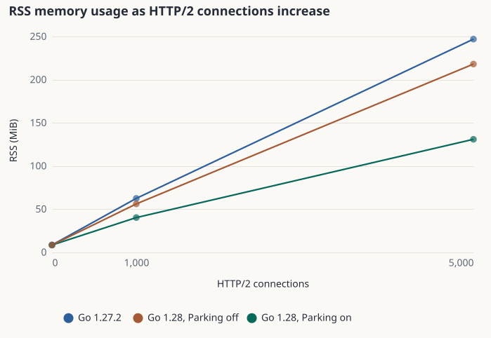
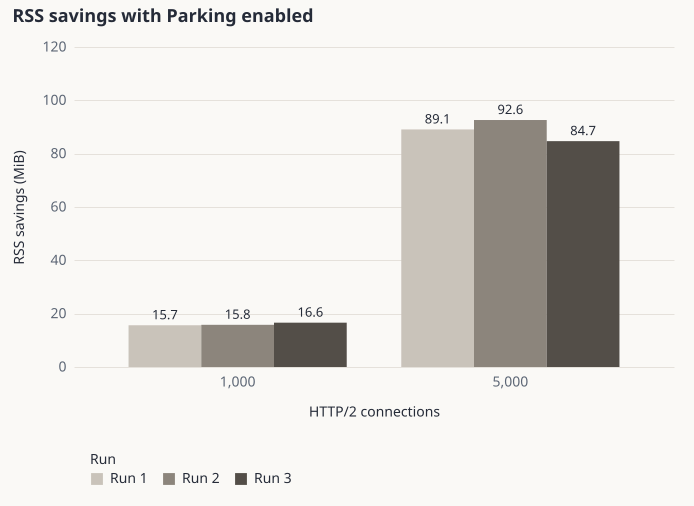
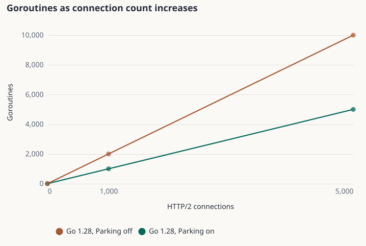
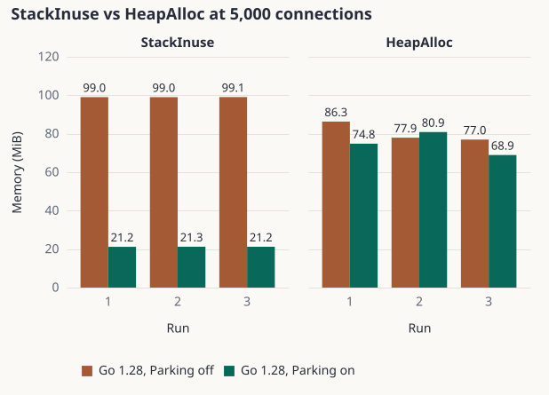

While reading the draft Go 1.28 release notes, I noticed a change in the HTTP/2 server. With this change, the goroutine responsible for serving a connection can exit when there is no work to do, instead of waiting. A new goroutine takes over when needed. At first, it seemed like a small change, but I wondered how much memory it could save on a server with thousands of open connections.

I decided to measure it rather than guess. I wanted to see how it affected process memory usage, goroutine counts, and Go runtime memory metrics.

## What is HTTP/2 parking?

An HTTP/2 connection can stay open even when it has no active streams. In the older server behavior, a goroutine stays in the connection's serving loop, waiting for more work. The Go 1.28 development code introduces an internal mechanism called *parking*. When a connection is idle and it is safe to do so, the serving goroutine can exit. A new serving goroutine can start when the connection needs attention again.

The word *parking* comes from the Go implementation, including identifiers such as `tryPark` and the temporary `GODEBUG` setting `http2serveparking`. It is not a new public API. The important change is what happens while connections are idle, not how application code handles requests.

This also gave me a useful way to test the change. I could run the same Go 1.28 server binary with parking enabled and disabled, instead of relying only on a Go 1.27 versus Go 1.28 comparison.

## How I tested it

I used the same benchmark code and machine for three configurations:

1. **Go 1.27.2**, as an older-version reference.
2. **Go 1.28 development build, parking enabled**, as the default behavior of the tested revision.
3. **The same Go 1.28 binary, parking disabled**, using `GODEBUG=http2serveparking=0`.

The tested Go 1.28 revision was `5c51011e82ed754af072baaf4338ff35e76fe705`. The benchmark source was pinned to commit `86753bd4d1f79621a4f3c6927c8239419e54bde2`.

For each configuration, I measured the server with **0, 1,000, and 5,000 idle HTTP/2 connections**. Each complete run used ten rounds for every case and connection count. I repeated the full experiment three times on the same Linux machine. The benchmark collected short sample windows after the connections had settled, and the published results use medians rather than a single sample.

The test machine used an Intel Core i7-1265U, Linux 6.18.56, and about 32 GiB of RAM. The benchmark configuration set `GOMAXPROCS=12` and `GOGC=100`. I kept the natural garbage collection behavior rather than forcing a collection before each measurement.

I looked at four metrics. **RSS** measures resident memory for the server process as reported by Linux. **Goroutines** shows how many goroutines the Go runtime reports. **StackInuse** describes memory in use by goroutine stacks. **HeapAlloc** is the amount of allocated heap memory reported by the runtime. These values are related, but they do not measure the same thing.

## RSS: the clearest change

The largest difference appeared at 5,000 idle connections. The table below shows median RSS from each complete run, in MiB:

| Run | Go 1.27.2 | Go 1.28, parking off | Go 1.28, parking on | Saved by parking |
| --- | ---: | ---: | ---: | ---: |
| 1 | 249.89 | 218.28 | 129.19 | 89.08 |
| 2 | 247.18 | 223.73 | 131.11 | 92.62 |
| 3 | 245.60 | 217.94 | 133.25 | 84.70 |

Compared with the **same Go 1.28 binary with parking disabled**, enabling parking reduced RSS by **84.7 to 92.6 MiB**, or about **38.9% to 41.4%**, across the three runs. At 1,000 idle connections, the reduction was smaller but still clear, at about **15.7 to 16.6 MiB**.

The zero-connection baseline stayed close to 8.5 to 8.7 MiB across the configurations. I also calculated baseline-adjusted RSS by subtracting each configuration's zero-connection median. That helps show the growth associated with idle connections, but the main comparison above uses the observed process RSS.

## Fewer goroutines, less stack memory

The goroutine counts helped explain the shape of the result. With 5,000 idle connections, Go 1.28 reported about **10,007 goroutines with parking disabled** and **5,007 with parking enabled**. That is a difference of exactly **5,000 goroutines** in this benchmark. At 1,000 idle connections, the difference was 1,000 goroutines.

The stack numbers moved in the same direction. At 5,000 connections, **StackInuse** was about **99 MiB with parking disabled** and about **21 MiB with parking enabled**. The reduction was close to **78 MiB** in all three complete runs.

This does not mean that every byte saved in RSS came from stacks. RSS includes more than Go stacks, and changes in heap allocation, runtime state, and the operating system can affect it. It does show that the lower goroutine and stack counts are consistent with the parking mechanism.

## HeapAlloc did not tell the same simple story

HeapAlloc was less consistent. In some runs, parking enabled used less heap than parking disabled. In another run, it used slightly more. This is a good reminder that one memory metric cannot stand in for another.

For this experiment, **RSS, goroutine count, and StackInuse** provide a clearer picture of the difference. I would not describe the change as a fixed heap saving or claim that a certain percentage of total memory always disappears.

## Limits of this benchmark

These measurements come from one machine, one benchmark design, and a specific **development revision** of Go 1.28. They are not results from a final Go 1.28 release. I tested mostly idle connections, not a mix of real traffic, active streams, and application workloads.

The benchmark kept the Go 1.28 server binary the same when switching parking on and off. That makes the parking comparison more useful, but it still does not remove all system noise. The three full runs show a repeatable direction and a range, not a universal guarantee.

I have kept the [benchmark source at a fixed commit](https://github.com/atkrad/benchmarks/tree/86753bd4d1f79621a4f3c6927c8239419e54bde2) and the [tested Go revision](https://github.com/golang/go/commit/5c51011e82ed754af072baaf4338ff35e76fe705) linked here so the details can be checked later.

## Conclusion

In this benchmark, HTTP/2 parking made a clear difference in memory usage. With 5,000 idle connections, the same Go 1.28 server binary used around 85 to 93 MiB less RSS when parking was enabled. It also had 5,000 fewer goroutines and used about 78 MiB less stack memory.

What I found most interesting was how much memory an otherwise quiet connection can keep around. Changing what the server does while it waits can matter as much as optimizing the work it performs.

I would not apply these numbers to every Go service. Still, for servers that keep many idle HTTP/2 connections open, this is a change worth understanding and measuring with a real workload.
