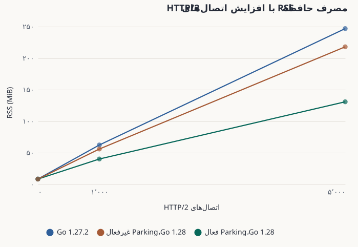
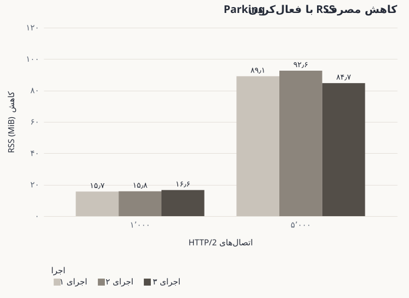
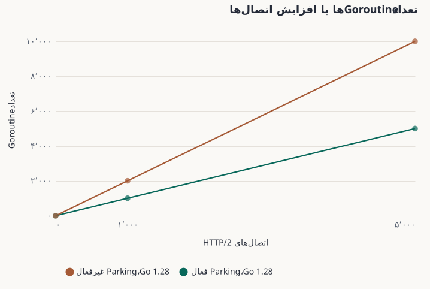
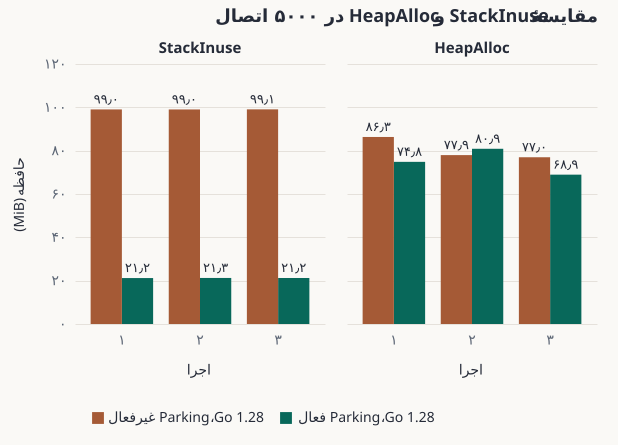

وقتی پیش‌نویس یادداشت‌های انتشار Go 1.28 را می‌خواندم، تغییری در سرور HTTP/2 توجهم را جلب کرد. طبق این تغییر، وقتی Goroutine مسئول پردازش یک اتصال، کاری برای انجام‌دادن ندارد، می‌تواند به‌جای منتظرماندن از اجرا خارج شود و در صورت نیاز، یک Goroutine جدید جای آن را بگیرد. در نگاه اول، تغییر کوچکی به نظر می‌رسید؛ اما برای سروری با هزاران اتصال باز، ممکن بود تأثیر قابل‌توجهی بر مصرف حافظه داشته باشد.

تصمیم گرفتم به‌جای حدس‌زدن، این تغییر را اندازه بگیرم. می‌خواستم ببینم چه تأثیری بر مصرف حافظهٔ فرایند، تعداد Goroutineها و معیارهای حافظهٔ Runtime دارد.

## Parking در HTTP/2 چیست؟

اتصال HTTP/2 ممکن است باز بماند، حتی وقتی هیچ `Stream` فعالی ندارد. در رفتار پیشین سرور، یک Goroutine تابع `serveLoop` را برای پردازش اتصال اجرا می‌کرد و هنگام نبود کار جدید منتظر می‌ماند. در کد در حال توسعهٔ Go 1.28، سازوکاری داخلی به نام *Parking* اضافه شده است. وقتی `serveLoop` کار آماده‌ای برای پردازش ندارد و شرایط لازم برقرار است، Goroutine آن می‌تواند خارج شود. با رسیدن کار جدید، `serveLoop` با یک Goroutine تازه دوباره اجرا می‌شود.

این سازوکار فقط به اتصال‌هایی محدود نیست که هیچ `Stream` فعالی ندارند. حتی اگر `Handler` فعالی وجود داشته باشد، ممکن است `serveLoop` در آن لحظه، کاری آمادهٔ پردازش نداشته باشد و شرایط Parking برقرار شود.

واژهٔ Parking از خود پیاده‌سازی Go آمده است؛ ازجمله نام‌هایی مانند `tryPark` و تنظیم موقت `GODEBUG` با نام `http2serveparking`. این واژه نام یک API عمومی جدید نیست و در پیش‌نویس یادداشت‌های انتشار نیز نام این تغییر نیست. موضوع اصلی، نحوهٔ مدیریت Goroutine مربوط به اتصال در سرور است، نه تغییری که برنامه‌نویس باید در کد درخواست‌های خود ایجاد کند.

این سازوکار فرصت مناسبی هم برای آزمایش فراهم می‌کرد: می‌توانستم همان فایل اجرایی ساخته‌شده از کد در حال توسعهٔ Go 1.28 را یک بار با Parking فعال و بار دیگر با Parking غیرفعال اجرا کنم. به این ترتیب، نتیجه فقط به مقایسهٔ Go 1.27 و Go 1.28 وابسته نبود.

## آزمایش را چگونه انجام دادم؟

برای هر سه حالت زیر از یک کد بنچمارک و یک ماشین استفاده کردم:

1. **Go 1.27.2**، به‌عنوان مرجع نسخهٔ قبلی.
2. **نسخه‌ای ساخته‌شده از کد در حال توسعهٔ Go 1.28 با Parking فعال**، مطابق رفتار پیش‌فرض Commit آزمایش‌شده.
3. **همان فایل اجرایی Go 1.28 با Parking غیرفعال**، با تنظیم `GODEBUG=http2serveparking=0`.

نسخهٔ آزمایش‌شدهٔ Go 1.28 به Commit با شناسهٔ `5c51011e82ed754af072baaf4338ff35e76fe705` مربوط است. کد بنچمارک نیز در Commit با شناسهٔ `86753bd4d1f79621a4f3c6927c8239419e54bde2` ثابت شده است.

در هر حالت، سرور را با **صفر، ۱۰۰۰ و ۵۰۰۰ اتصال باز HTTP/2 بدون درخواست فعال** اندازه گرفتم. هر اجرای کامل شامل ده دور برای هر حالت و تعداد اتصال بود. کل آزمایش را سه بار روی همان ماشین تکرار کردم. پس از پایدارشدن اتصال‌ها، نمونه‌های حافظه جمع‌آوری شدند و نتیجه‌ها بر پایهٔ میانه محاسبه شدند، نه یک نمونهٔ اتفاقی.

ماشین آزمایش از پردازندهٔ Intel Core i7-1265U، لینوکس با Kernel نسخهٔ 6.18.56 و حدود ۳۲ GiB حافظه استفاده می‌کرد. در تنظیمات بنچمارک، مقدار `GOMAXPROCS` برابر ۱۲ و `GOGC` برابر ۱۰۰ بود. برای هر اندازه‌گیری، اجرای اجباری Garbage Collection را به آزمایش تحمیل نکردم.

چهار معیار را بررسی کردم. **RSS** میزان حافظهٔ مقیم فرایند را از دید لینوکس نشان می‌دهد. **Goroutines** تعداد Goroutineهای گزارش‌شدهٔ Go است. **StackInuse** حافظهٔ در حال استفاده برای Stackها را نشان می‌دهد و **HeapAlloc** مقدار حافظهٔ تخصیص‌یافته در Heap است. این معیارها با هم ارتباط دارند، اما یک چیز را اندازه نمی‌گیرند.

## RSS: روشن‌ترین تفاوت

بزرگ‌ترین اختلاف را در ۵۰۰۰ اتصال باز HTTP/2 بدون درخواست فعال دیدم. جدول زیر میانهٔ RSS را در سه اجرای کامل، برحسب MiB، نشان می‌دهد:

| اجرا | Go 1.27.2 | Go 1.28، Parking غیرفعال | Go 1.28، Parking فعال | کاهش با Parking |
| --- | ---: | ---: | ---: | ---: |
| ۱ | 249.89 | 218.28 | 129.19 | 89.08 |
| ۲ | 247.18 | 223.73 | 131.11 | 92.62 |
| ۳ | 245.60 | 217.94 | 133.25 | 84.70 |

در مقایسه با **همان فایل اجرایی Go 1.28، اما با Parking غیرفعال**، فعال‌بودن Parking مصرف RSS را در سه اجرای آزمایش بین **۸۴٫۷ تا ۹۲٫۶ MiB** کاهش داد. این مقدار معادل حدود **۳۸٫۹ تا ۴۱٫۴ درصد** است. با ۱۰۰۰ اتصال باز بدون درخواست فعال نیز کاهش RSS حدود **۱۵٫۷ تا ۱۶٫۶ MiB** بود.

در حالت بدون اتصال، مقدار RSS در هر سه پیکربندی نزدیک به ۸٫۵ تا ۸٫۷ MiB بود. مصرف RSS را پس از کسر مقدار پایهٔ هر پیکربندی هم محاسبه کردم. این معیار برای دیدن رشد حافظه با افزایش تعداد اتصال مفید است؛ اما مقایسهٔ اصلی بالا بر اساس RSS مشاهده‌شدهٔ فرایند انجام شده است.

## Goroutine کمتر، حافظهٔ Stack کمتر

تعداد Goroutineها به توضیح این نتیجه کمک می‌کند. در ۵۰۰۰ اتصال باز HTTP/2 بدون درخواست فعال، Go 1.28 با Parking غیرفعال حدود **۱۰۰۰۷ Goroutine** و با Parking فعال حدود **۵۰۰۷ Goroutine** داشت. یعنی در این بنچمارک، اختلاف دقیقاً **۵۰۰۰ Goroutine** بود. با ۱۰۰۰ اتصال نیز اختلاف ۱۰۰۰ Goroutine بود.

تغییر حافظهٔ Stack هم در همین جهت بود. در ۵۰۰۰ اتصال، مقدار **StackInuse** با Parking غیرفعال حدود **۹۹ MiB** و با Parking فعال حدود **۲۱ MiB** بود. در هر سه اجرای کامل، کاهش این مقدار به **۷۸ MiB** نزدیک بود.

البته این اعداد به این معنا نیستند که تمام کاهش RSS مستقیماً از آزادشدن Stackها آمده است. RSS فقط حافظهٔ Stack را نشان نمی‌دهد و تغییرات Heap، وضعیت Runtime و رفتار سیستم‌عامل نیز در آن اثر دارند. بااین‌حال، کاهش تعداد Goroutineها و StackInuse با سازوکار Parking سازگار است.

## HeapAlloc رفتار یکسانی نداشت

نتیجهٔ **HeapAlloc** به اندازهٔ RSS روشن نبود. در بعضی اجراها، مقدار HeapAlloc با Parking فعال کمتر بود؛ اما در یک اجرا کمی بیشتر شد. این تفاوت یادآوری می‌کند که نمی‌توان یک معیار حافظه را جایگزین معیار دیگر کرد.

در این آزمایش، ترکیب **RSS، تعداد Goroutineها و StackInuse** تصویر روشن‌تری از تغییر ارائه می‌دهد. بنابراین درست نیست که از این داده‌ها یک مقدار ثابت برای صرفه‌جویی در Heap نتیجه بگیریم یا ادعا کنیم که در هر سرویس Go همین درصد از حافظه کاهش پیدا می‌کند.

## محدودیت‌های آزمایش

این اندازه‌گیری‌ها روی یک ماشین، با یک سناریوی مشخص و یک **نسخهٔ ساخته‌شده از کد در حال توسعهٔ Go 1.28** انجام شده‌اند. نتایج مربوط به نسخهٔ نهایی Go 1.28 نیستند. تمرکز آزمایش بر اتصال‌های باز HTTP/2 بدون درخواست فعال بود، نه ترکیبی از ترافیک واقعی، Streamهای فعال و منطق برنامه.

وقتی Parking را فعال و غیرفعال کردم، فایل اجرایی Go 1.28 یکسان بود. این موضوع مقایسه را قابل‌اتکاتر می‌کند، اما تمام نوسان‌های محیط اجرا را حذف نمی‌کند. سه اجرای کامل، تکرارپذیری جهت تغییر و بازهٔ مشاهده‌شده را نشان می‌دهند، نه تضمینی برای تمام محیط‌ها.

تنظیم `GODEBUG=http2serveparking=0` که برای این مقایسه استفاده کردم، موقتی و مستندنشده است. نباید آن را یک گزینهٔ عمومی و تضمین‌شده برای نسخه‌های منتشرشدهٔ آینده در نظر گرفت.

برای بررسی جزئیات در آینده، [کد بنچمارک در Commit مشخص](https://github.com/atkrad/benchmarks/tree/86753bd4d1f79621a4f3c6927c8239419e54bde2) و [نسخهٔ دقیق کد Go](https://github.com/golang/go/commit/5c51011e82ed754af072baaf4338ff35e76fe705) را لینک کرده‌ام.

## نتیجه‌گیری

در این بنچمارک، Parking در HTTP/2 تفاوت روشنی در مصرف حافظه ایجاد کرد. با ۵۰۰۰ اتصال باز بدون درخواست فعال، همان فایل اجرایی Go 1.28 در حالت Parking فعال حدود ۸۵ تا ۹۳ MiB حافظهٔ RSS کمتری مصرف کرد. تعداد Goroutineها نیز ۵۰۰۰ عدد کمتر بود و StackInuse حدود ۷۸ MiB کاهش یافت.

برای من جالب‌ترین بخش آزمایش این بود که یک اتصال باز، حتی بدون درخواست فعال، چقدر می‌تواند حافظه را درگیر نگه دارد. گاهی تغییر رفتار سرور هنگام انتظار، به اندازهٔ بهینه‌کردن کاری که انجام می‌دهد اهمیت دارد.

این اعداد را نمی‌توان به تمام سرویس‌های Go تعمیم داد. بااین‌حال، اگر سروری تعداد زیادی اتصال HTTP/2 را بدون درخواست فعال باز نگه می‌دارد، این تغییر ارزش شناختن و اندازه‌گیری در بار کاری واقعی را دارد.
